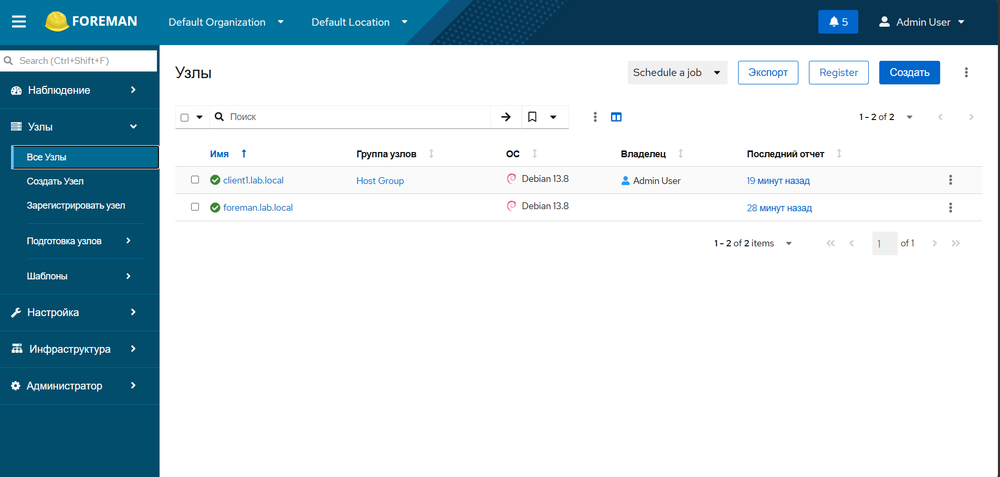

# Тестовое задание: Развёртывание и настройка Foreman + Ansible

## 1. Архитектура тестового стенда
Стенд развёрнут локально в среде виртуализации VirtualBox на базе ОС **Debian 13 (Trixie, x86_64)** и состоит из двух виртуальных машин, объединённых во внутреннюю изолированную сеть (`192.168.100.0/24`):

* **VM1 (`foreman.lab.local` / `192.168.100.10`):** Сервер управления Foreman 5.0 с установленными плагинами `foreman_plugin_ansible` и `foreman_proxy_plugin_ansible`.
* **VM2 (`client1.lab.local` / `192.168.100.20`):** Управляемый хост (Managed Host), зарегистрированный в Foreman через механизм *Global Registration* и привязанный к созданной группе узлов.

---

## 2. Выполненные шаги и описание конфигурации

### 2.1. Интеграция с Ansible и роль запрета входа `root`
На сервере Foreman создана роль `Запрещаем вход под root по SSH` в директории `/etc/ansible/roles/disable_root_ssh/tasks/main.yml` и импортирована в веб-интерфейс 

**Как работает роль:**
1. Модуль `lineinfile` открывает `/etc/ssh/sshd_config`, находит строку `PermitRootLogin` и заменяет её на `PermitRootLogin no`.
2. Модуль `service` перезапускает службу `ssh`, чтобы новые параметры сразу вступили в силу.


### 2.2. Provisioning Template с настройкой NTP
На базе стандартного шаблона `Preseed default` создан пользовательский шаблон `Preseed default Debian13` (`templates/preseed default Debian13.erb`)

В блок постобработки `d-i preseed/late_command` добавлена автоматическая установка и настройка службы синхронизации времени `chrony`:
```bash
in-target apt-get update && in-target apt-get install -y chrony && in-target bash -c 'echo "pool 0.ru.pool.ntp.org iburst" >> /etc/chrony/chrony.conf' && in-target systemctl enable chrony
```


### 2.3. Настройка Host Group и регистрация Managed Host
1. Создана группа узлов (**Host Group**), объединяющая ОС Debian 13, шаблон развёртывания с NTP и Ansible-роль `disable_root_ssh` 


2. Узел `client1.lab.local` зарегистрирован в Foreman с привязкой к созданной группе узлов 


3. Через веб-интерфейс Foreman запущено применение унаследованных Ansible-ролей (*Run Ansible roles*). Задача завершилась со статусом **Succeeded** 


4. Проверка на стороне клиента (`grep PermitRootLogin /etc/ssh/sshd_config`) подтвердила, что вход под `root` отключён (`PermitRootLogin no`)


---

## 3. Сравнение подходов: Foreman vs ручной стек (Docker + Nginx + Samba)
.

| Критерий | Ручной стек (Docker + Nginx + Samba) | Foreman (+ Ansible) |
| :--- | :--- | :--- |
| **Суть подхода** | Файловая раздача: сервер отдаёт образы, скрипты и конфиги по HTTP/SMB. | Оркестратор полного цикла: от установки ОС (Provisioning) до контроля конфигураций. |
| **Учёт и инвентаризация** | Ведётся вручную (таблицы, заметки). Нет единой актуальной базы хостов. | **Single Source of Truth:** единый реестр всех узлов, их железа (Facts), IP/MAC и статусов. |
| **Контроль дрейфа (Идемпотентность)** | Скрипт выполняется один раз при установке. Если конфиг потом поменяют руками, система об этом не узнает. | Интеграция с Ansible позволяет повторно приводить серверы к эталону и отслеживать изменения в отчётах. |
| **Стандартизация и группы** | При росте парка машин приходится править множество разрозненных скриптов. | **Host Groups** задают единый профиль сервера (ОС + NTP + роли Ansible) для массового тиражирования. |
| **Безопасность и аудит** | Общие сетевые папки и пароли, нет разграничения прав и истории запусков. | Ролевая модель доступа (RBAC), работа по SSH-ключам через Smart Proxy и полный журнал всех задач. |
### 3.1. Плюсы и минусы Foreman (впечатления по итогам настройки стенда)

#### Плюсы
* **Всё в одном окне:** очень удобно, что не нужно прыгать между консолью, табличками с IP-адресами и папками со скриптами. В одном веб-интерфейсе видно и список серверов, и их железо (Facts), и статусы выполнения Ansible.
* **Удобное тиражирование через Host Groups:** один раз собрал шаблон с нужной ОС, настройкой NTP и ролями Ansible — и дальше новые виртуалки можно поднимать по единому стандарту, не настраивая каждую с нуля.
* **Контроль изменений и отчёты:** в отличие от обычного bash-скрипта, который отработал при установке и забылся, связка с Ansible позволяет периодически проверять конфиги и видеть в веб-морде, если где-то что-то пошло не так.
* **Безопасность и разграничение прав:** не нужно раскидывать пароли или хранить открытые шары. Работа идёт через SSH-ключи Smart Proxy, а в системе остаётся история, кто и что запускал.

#### Минусы (с чем пришлось столкнуться на практике)
* **Требовательность к ресурсам:** даже для моего небольшого стенда из двух ВМ самому серверу Foreman нужно прилично оперативной памяти и CPU — на совсем слабой машине ему тяжело.
* **Строгие требования к сети и DNS при установке:** `foreman-installer` очень чувствителен к настройкам полного доменного имени и резолвингу. Если заранее не прописать всё корректно в `/etc/hosts` или DNS, установка может прерваться с ошибками сертификатов или сервисов.
* **Зависимость от плагинов и свежих дистрибутивов:** нужный функционал (например, тот же Ansible) идёт отдельными плагинами, а стандартные шаблоны (как в случае с новой Debian 13) иногда приходится допиливать руками под актуальные реалии.
* **Избыточен для пары серверов:** если нужно поднять 2–3 тестовые машины на один раз, быстрее сделать это руками или прогнать обычный Ansible из консоли. Foreman начинает реально экономить время, когда машин становится больше и их нужно поддерживать в едином состоянии.
